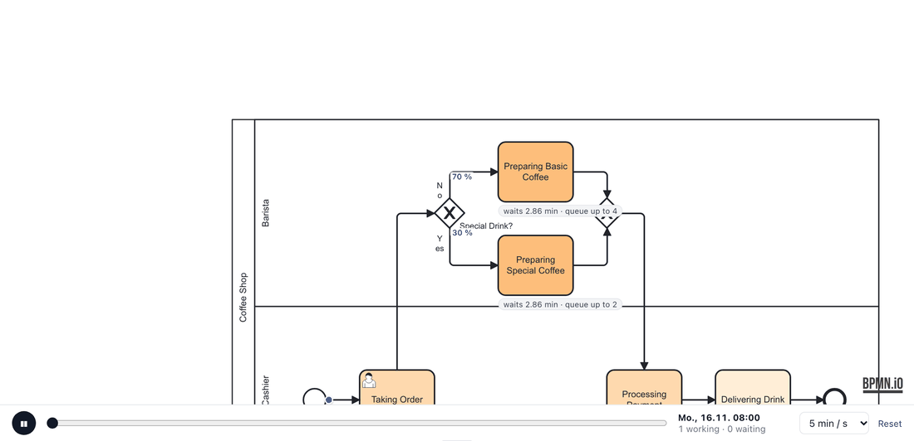
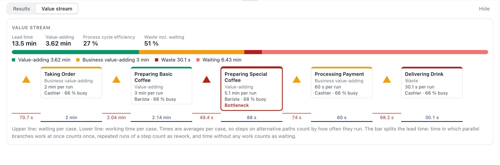
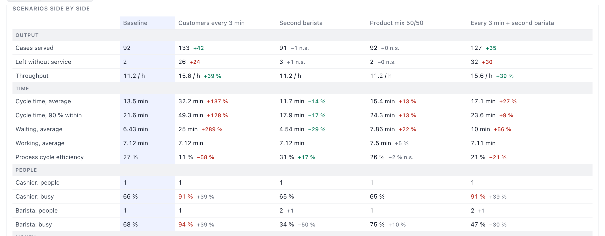
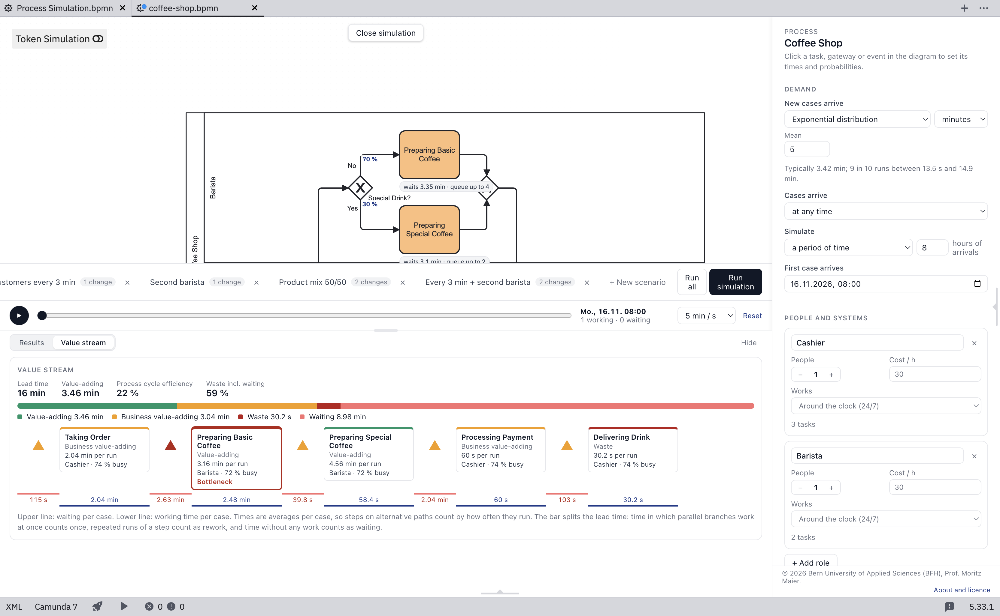

# Process Simulator

A BPMN 2.0 process simulator that runs in the browser, developed by Prof. Moritz Maier, Bern University of Applied Sciences (BFH).

[](https://doi.org/10.5281/zenodo.24219723) [](https://github.com/BFH-Process-Digitalization/process-simulator/releases/latest) [](LICENSE) [](https://github.com/BFH-Process-Digitalization/process-simulator/actions/workflows/pages.yml) [](https://bfh-process-digitalization.github.io/process-simulator/) [](https://github.com/BFH-Process-Digitalization/process-simulator/releases/latest/download/process-simulator-camunda-plugin-1.0.1.zip)  



## What it does

**Model and simulate**

- Open a BPMN 2.0 file or draw a process; set times, branch probabilities, roles, working hours, costs and queue limits by clicking elements in the diagram.
- Watch cases flow through the model: token playback, live clocks, queue badges and waiting-time colouring on the diagram itself.

**Compare scenarios with statistics**

- Every scenario runs as many replications as you set; replication *i* of each scenario draws the same random numbers, so differences are paired.
- Results show 95 % confidence intervals; paired differences that are not significant are marked *n.s.*
- Common random numbers give every random source (arrivals, each activity and gateway) its own stream per case and per visit, so changing one part of a scenario leaves the other draws unchanged.

**Value stream view**

- Classify tasks as value-adding, business value-adding or waste and see the lead time split into value-adding, business-value-adding, waste, rework and waiting along each simulated case.
- Because it is computed from simulated intervals, it also holds for branches, parallel work and loops where a linear map would just add all activity times.
- Process cycle efficiency, rework and the bottleneck are shown per step.



**Reports**

- Compare all scenarios side by side and export the comparison as an Excel or PDF report, plus CSV results and event logs (CSV/XES).



**Camunda Modeler plugin**

- The same simulator as a [Camunda Modeler](https://camunda.com/download/modeler/) plugin: a **Simulation** button on every BPMN diagram, same settings, results and playback. [Download the plugin](https://github.com/BFH-Process-Digitalization/process-simulator/releases/latest/download/process-simulator-camunda-plugin-1.0.1.zip) from the latest release and follow the [install instructions](https://github.com/BFH-Process-Digitalization/process-simulator/wiki/Camunda-Modeler-plugin).



**Command line and Prosimos**

- Batch runs and reproducible experiments without a browser, and exchange of scenarios with the [Prosimos](https://github.com/AutomatedProcessImprovement/Prosimos) simulator (import and export).

## Quick start

- **Open the app:** https://bfh-process-digitalization.github.io/process-simulator/ (it loads the coffee-shop example; click **Run simulation**).
- **Or run locally:**

```bash
npm install
npm run dev        # http://localhost:5173
```

## Command line

The simulation engine also runs without a browser, for batch experiments and reproducible pipelines:

```bash
npm run build:cli
node dist-cli/procsim.mjs run model.bpmn --reps 30 --out runs.jsonl
node dist-cli/procsim.mjs prosimos model.bpmn --out prosimos.json
```

```
Process Simulator command line

  procsim scenarios <model.bpmn>
  procsim run <model.bpmn> [options]
  procsim prosimos <model.bpmn> [--scenario <id> | --params <file.json>] [--out <params.json>]

Options for run:
  --scenario <id|all>   scenario stored in the model (default: all)
  --params <file.json>  scenario as JSON instead of the stored ones
  --prosimos <file.json> scenario from Prosimos parameters (e.g. discovered by Simod)
  --start <ISO date>    first arrival, with --prosimos
  --reps <n>            replications per scenario (default: the scenario's setting, else 1)
  --seed <n>            base seed (replication i uses a seed derived from it)
  --cases <n>           number of cases
  --warmup <seconds>    leave out cases arriving before this time
  --rng keyed|single    random numbers per case and source (default) or one stream
  --activities          also write per-activity and per-resource numbers
  --max-events <n>      event safety cap per run (default 3000000)
  --out <file.jsonl>    write to a file instead of standard output
```

Each run writes one JSON line: tool name and version, hashes of the model and the scenario, seed and random-number mode, case counts, the metrics (cycle, waiting, cost, value stream figures) and any warnings; `--activities` adds per-activity and per-resource numbers. The full format is documented in [Command line](https://github.com/BFH-Process-Digitalization/process-simulator/wiki/Command-line).

## Verification

The engine is checked against exact queueing results (M/M/1, M/M/c, M/G/1, tandem and Jackson networks) and cross-checked against the Prosimos simulator on shared models. Experiments, data and analysis live in [process-simulator-paper](https://github.com/BFH-Process-Digitalization/process-simulator-paper).

## Documentation

The [wiki](https://github.com/BFH-Process-Digitalization/process-simulator/wiki) has the full documentation:

- [Getting started](https://github.com/BFH-Process-Digitalization/process-simulator/wiki/Getting-started): the screen and your first simulation
- [Results](https://github.com/BFH-Process-Digitalization/process-simulator/wiki/Results) and [Comparing and reports](https://github.com/BFH-Process-Digitalization/process-simulator/wiki/Comparing-and-reports), including Excel and PDF export
- [Value stream](https://github.com/BFH-Process-Digitalization/process-simulator/wiki/Value-stream): the classification and the figures
- [Statistics](https://github.com/BFH-Process-Digitalization/process-simulator/wiki/Statistics): replications, confidence intervals and common random numbers
- [Concepts](https://github.com/BFH-Process-Digitalization/process-simulator/wiki/Concepts): distributions, arrivals, Little's Law and utilisation
- [Command line](https://github.com/BFH-Process-Digitalization/process-simulator/wiki/Command-line)
- [Camunda Modeler plugin](https://github.com/BFH-Process-Digitalization/process-simulator/wiki/Camunda-Modeler-plugin)
- [Reference](https://github.com/BFH-Process-Digitalization/process-simulator/wiki/Reference)
- [Development](https://github.com/BFH-Process-Digitalization/process-simulator/wiki/Development)

## Cite

Please cite the archived release:

> Maier, M. (2026). *Process Simulator* (Version 1.0.1) [Computer software]. Zenodo. https://doi.org/10.5281/zenodo.24219723

GitHub's "Cite this repository" button and [CITATION.cff](CITATION.cff) give the same reference in BibTeX and APA.

## Credits

Built on [bpmn-js](https://github.com/bpmn-io/bpmn-js) by [bpmn.io](https://bpmn.io), [React](https://github.com/facebook/react) and other open source projects. See [Credits and licences](https://github.com/BFH-Process-Digitalization/process-simulator/wiki/Credits-and-licences) and [THIRD_PARTY_NOTICES.md](THIRD_PARTY_NOTICES.md).

## Licence

© 2026 Bern University of Applied Sciences (BFH), Prof. Moritz Maier.

Process Simulator is open source under the [Apache License, Version 2.0](LICENSE). If you redistribute it or a modified version, keep the copyright notice and the [NOTICE](NOTICE) file and mark your changes.
